# ESP32 Bit Pirate 架构研究笔记

> 研究对象：当前工作区 `ESP32-Bit-Pirate`，分支 `pioarduino`，提交 `724f1097`。  
> 方法：静态阅读源码、构建配置、测试与 CI，不运行硬件。本文所有结论均可在文末“关键文件索引”中找到出处。  
> 规模：`src/` 约 432 个源文件、83k 行；`test/` 57 个测试文件、约 12.5k 行；`platformio.ini` 定义 20 个固件环境 + 1 个原生测试环境。

---

## 1. 项目定位

ESP32 Bit Pirate 是运行在 ESP32-S3 上的多协议分析/调试固件，定位类似 Bus Pirate：

- 通过 USB 串口、Wi-Fi Web 终端或 Cardputer 本体键盘输入命令；
- 用统一 CLI 操作 I2C、SPI、UART、1-Wire、2-Wire、3-Wire、DIO、LED、红外、USB、蓝牙、Wi-Fi、JTAG、I2S、CAN、以太网、Sub-GHz、RFID、RF24、FM、蜂窝、LoRa 等模式；
- 支持被动嗅探、逻辑分析、信号分析、EEPROM/Flash 读写、脚本化 bytecode；
- 可以把设备重启成专用 USB 适配器（USB-UART、flashrom、AVRDUDE、SUMP、OpenOCD、IR Toy、BPIO2、SDR 等）。

它不是一个 RTOS 多任务应用，而是一个**单线程命令循环 + 少量后台任务/ISR**的固件：主循环从终端读一行命令，解析后交给对应的 Controller，Controller 调用 Service 操作硬件，再把结果写回终端。

---

## 2. 技术栈与构建矩阵

### 2.1 基础技术栈

| 项 | 内容 |
|---|---|
| 语言 | C++17（`-std=gnu++17` 用于原生测试） |
| 构建 | PlatformIO |
| 框架 | Arduino-ESP32，底层 ESP-IDF 5.x |
| 平台锁定 | pioarduino `platform-espressif32` 55.03.37（`platformio.ini` 顶部注释说明：避免最新稳定版 RAM 占用上升） |
| RTOS | FreeRTOS（网络、ICMP、部分服务使用 task） |
| USB | TinyUSB：CDC ×2、HID、MSC |
| Web | `esp_http_server` + WebSocket + 内嵌 HTML/CSS/JS |
| 存储 | NVS、LittleFS（SPIFFS 分区标签）、SD 卡 |
| 测试 | Unity + 原生 (`platform = native`) + Fake 服务/视图 |

### 2.2 关键依赖

`platformio.ini` 的 `[env]` 中统一声明：

- `fastled/FastLED`：LED 协议
- `bblanchon/ArduinoJson`：JSON
- `paulstoffregen/OneWire`、`pstolarz/OneWireNg`：1-Wire
- `hideakitai/ESP32SPISlave`：SPI 从机
- `gilman88/XModem`：文件传输
- `ewpa/LibSSH-ESP32`：SSH
- `autowp/autowp-mcp2515`：CAN
- `sparkfun/SparkFun External EEPROM`：I2C EEPROM
- `miq19/eModbus`：Modbus
- `adafruit/Adafruit Si4713`：FM 发射
- 各板 env 额外引入 `crankyoldgit/IRremoteESP8266`、`LovyanGFX`、M5Unified/M5Cardputer 等

### 2.3 固件环境

`platformio.ini` 中有 20 个固件 env，主要包括：

- 通用/自定义：`custom`
- M5：`cardputer`、`cardputer-adv`、`m5stack-sticks3`、`m5stack-stamps3`、`atom-lite-s3`
- 通用 ESP32-S3：`s3-devkit`、`s3-devkit-n16-r8`、`s3-supermini`、`s3-devkit-n16r8-lcd`
- LILYGO：`t-display-s3`、`t-embed-s3`、`t-embed-s3-cc1101`、`t-embed-s3-cc1101plus`
- 其他：`waveshare-s3-geek`、`xiao-esp32s3`、`vision-master-t190`、`heltec_wifi_lora_32_V4`、`heltec_wifi_lora_32_V3`、`um_pros3`

每个 env 通过 `-DDEVICE_*` 选择板级实现，通过 `-D*_PIN` 注入引脚。`src/States/GlobalState.h` 的构造函数会读取这些宏作为默认值。

分区表有三套：

- `app4M_spiffs_4M_8MB.csv`：4MB app + 约 3.9MB SPIFFS，用于 8MB Flash
- `app4M_spiffs_12M_16MB.csv`：4MB app + 约 12MB SPIFFS，用于 16MB Flash
- `app3776K_spiffs_256K_4MB.csv`：约 3.7MB app + 256KB SPIFFS，用于 4MB Flash

---

## 3. 代码分层

项目按“职责”而不是按“协议”分目录，核心分层如下：

| 目录 | 职责 | 规模（约） |
|---|---|---|
| `src/main.cpp` | 启动、板级选择、终端选择、依赖装配入口 | 296 行 |
| `src/Dispatchers/` | 命令路由与主循环 | 471 行 |
| `src/Providers/` | 手工依赖注入容器，持有所有单例组件 | 643 行 |
| `src/Controllers/` | 面向用户的高层流程：命令分派、参数校验、交互 | 25 个控制器，16k 行 |
| `src/Shells/` | 多步骤交互子流程（EEPROM、Flash、AT、Modbus、Profile 等） | 22 个 Shell，7.8k 行 |
| `src/Services/` | 协议/硬件低层实现 | 40 个服务，19k 行 |
| `src/Transformers/` | 字符串/参数/协议数据转换 | 12 个转换器，5.3k 行 |
| `src/Managers/` | 命令历史、别名、用户输入、启动内存 | 1.4k 行 |
| `src/Analyzers/` | 二进制、引脚、I2C 频率、Sub-GHz 分析 | 2.1k 行 |
| `src/Boards/` | 板级初始化、屏幕、按键、主机串口 | 12 个目录，8.5k 行 |
| `src/Interfaces/` | 服务/视图/输入抽象，供测试替换 | 46 个头文件 |
| `src/Adapters/` | 一次性 USB CDC 适配器模式 | 9 个适配器，5.6k 行 |
| `src/Servers/` | HTTP、WebSocket、DNS | 653 行 |
| `src/Views/`、`src/Inputs/` | 终端输出/输入通道 | 约 220 行 |
| `src/States/` | 全局可变状态 `GlobalState` | 721 行 |
| `src/Data/`、`src/Models/`、`src/Enums/` | 静态表、数据结构、枚举映射 | 交叉使用 |

依赖方向可以概括为：

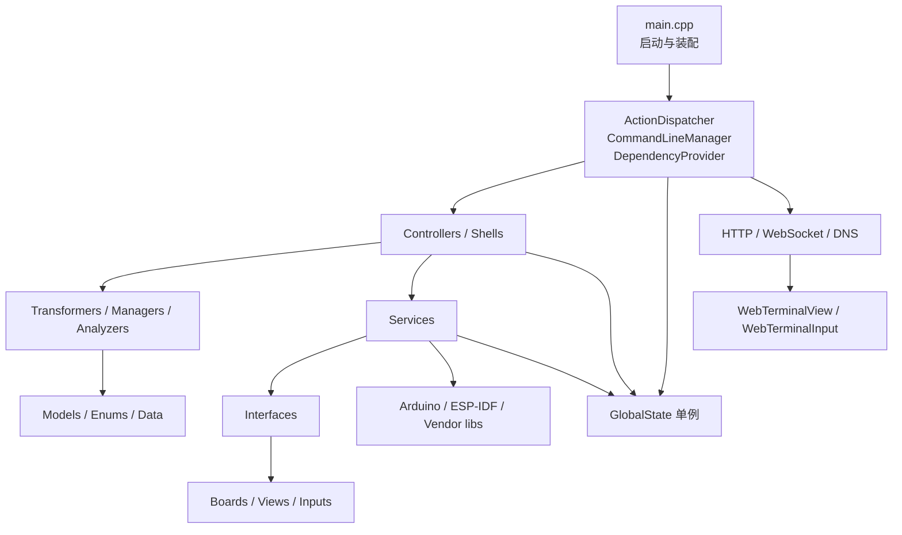

一个重要的设计约束：**Controller 依赖接口，而不是具体 Service**。例如 `I2cController` 的构造函数接收 `II2cService&`、`II2cSnifferService&`；真实固件由 `DependencyProvider` 注入 `I2cService`，原生测试则注入 `FakeI2cService`。这是该项目可测试性的基础。

---

## 4. 总体架构图

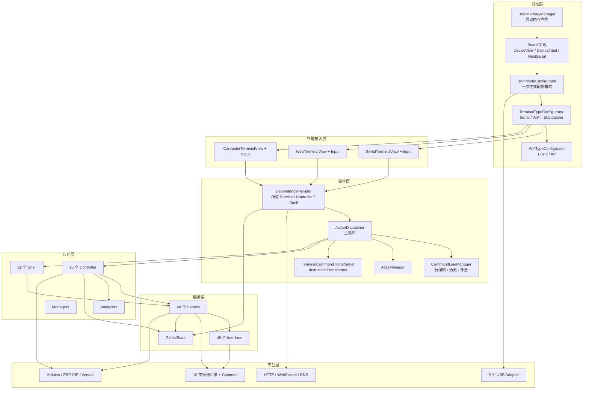

---

## 5. 启动流程

### 5.1 启动流程图

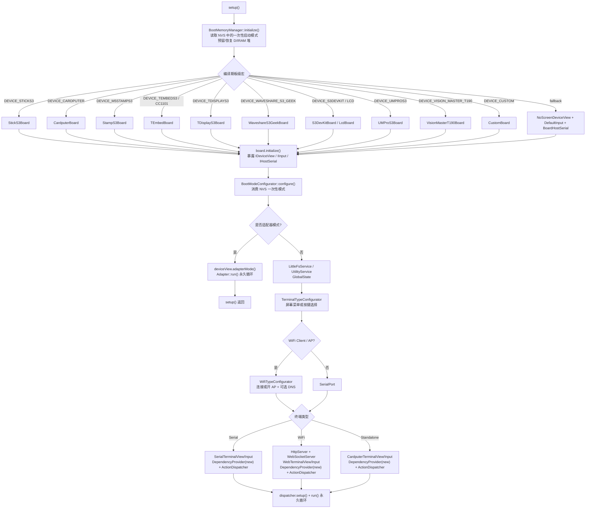

### 5.2 启动阶段的三个关键点

1. **先处理内存，再初始化板子**  
   `BootMemoryManager::initialize()` 在 `main.cpp` 最前面调用。它直接用 `nvs_open` 读取 pending 模式，而不是先创建 `NvsService`。原因是要在 Arduino/板级初始化之前决定 D/IRAM 堆如何注册。

2. **一次性适配器模式在正常 CLI 之前拦截**  
   `BootModeConfigurator::configure()` 从 NVS 取出模式并清除配置；如果模式不是 `None`，就调用对应 Adapter 的 `run()`，该函数不会返回，`setup()` 直接结束。下次复位后 NVS 中没有 pending 模式，恢复普通 CLI。

3. **DependencyProvider 必须放在堆上**  
   `main.cpp` 的注释明确说明“too big to fit on the stack anymore”。所有 Service、Controller、Shell 都是 Provider 的成员，对象非常大，因此用 `new DependencyProvider(...)`，生命周期覆盖整个 `run()`。

---

## 6. 运行时主循环与命令流水线

### 6.1 主循环时序

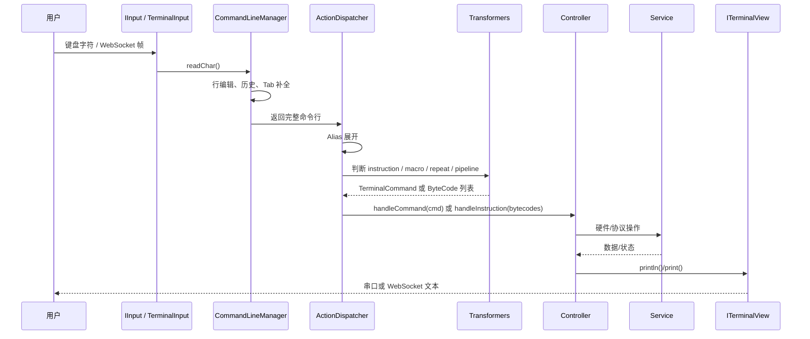

### 6.2 命令分派流程

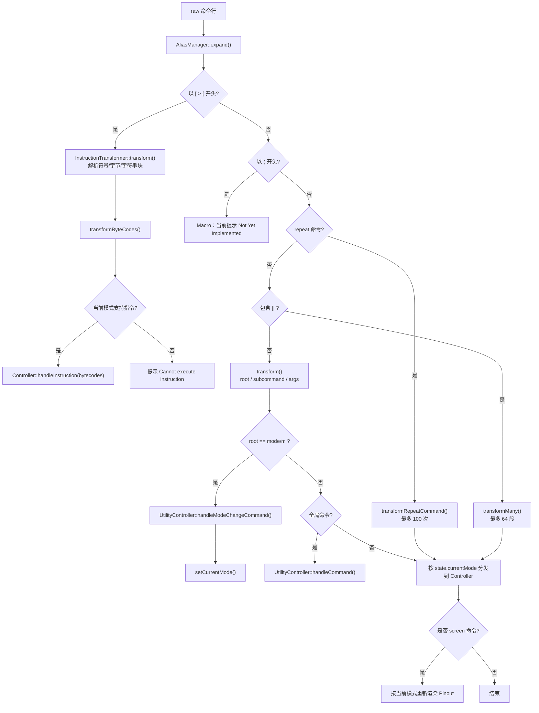

### 6.3 命令解析细节

`TerminalCommand` 只有三个字段：

```text
root       第一个 token
subcommand 第二个 token
args       其余整行
```

例如 `ping 0x3C` → root=`ping`，subcommand=`0x3C`，args=空。  
例如 `spam Hello 10` → root=`spam`，subcommand=`Hello`，args=`10`。

`TerminalCommandTransformer` 还做两件“容错”工作：

- 根命令统一小写；如果根命令本身就是模式名（如 `uart`），自动改写成 `mode uart`；
- 用“紧凑编辑距离”做最多 1 个字符的纠错（增加、删除、替换、相邻换位），且只有唯一候选时才应用，避免把命令改成另一个合法命令。

其他命令语法：

| 语法 | 含义 | 限制 |
|---|---|---|
| `cmd || cmd2 || cmd3` | 顺序执行多条命令 | 最多 64 段 |
| `repeat 10 cmd` | 重复执行 | 最多 100 次 |
| `repeat 10 cmd || cmd2` | 重复一个管道 | 同上 |
| `[ ... ]`、`{ ... }`、`> ...` | Bus Pirate 风格 bytecode 指令块 | 仅部分模式支持 |
| `( ... )` | 宏 | 预留，当前未实现 |
| `alias` | 命令别名 | `AliasManager` |

Bytecode 指令由 `InstructionTransformer` 转成 `ByteCode`（`Write`、`Read`、`Start`、`Stop`、`DelayUs`、`DelayMs`、`SetClkHigh`、`AuxHigh`、`Adc` 等），再由对应 Service 的 `executeByteCode()` 解释执行。I2C 的 bytecode 解释器会把第一个 `Write` 当作地址，后续 `Write` 当作数据，`Read` 触发 `requestFrom`。

### 6.4 `CommandLineManager` 的输入处理

`readCommand()` 是阻塞式字符循环，但支持完整的行编辑：

- `\r`/`\n`：提交；
- `\b`/`127`：退格；
- `ESC [ A/B/C/D`：上下历史、左右移动；
- `\t`：先查历史补全，再查 `AutoCompleteWords.h` 字典；
- Cardputer Standalone 模式有特殊方向键与 Tab 处理；
- 每次循环都调用一次 `deviceInput.readChar()`，用于 T-Embed 等板子的关机/按键检测。

最大命令长度由 `MAX_COMMAND_LENGTH` 限制（`CommandLineManager.h`）。

---

## 7. 模式与资源生命周期

### 7.1 模式状态图

```mermaid
stateDiagram-v2
    [*] --> HIZ
    HIZ --> OneWire: mode 1wire
    HIZ --> UART: mode uart
    HIZ --> HDUART: mode hduart
    HIZ --> I2C: mode i2c
    HIZ --> SPI: mode spi
    HIZ --> TwoWire: mode 2wire
    HIZ --> ThreeWire: mode 3wire
    HIZ --> DIO: mode dio
    HIZ --> LED: mode led
    HIZ --> Infrared: mode infrared
    HIZ --> USB: mode usb
    HIZ --> Bluetooth: mode bluetooth
    HIZ --> WiFi: mode wifi
    HIZ --> JTAG: mode jtag
    HIZ --> I2S: mode i2s
    HIZ --> CAN: mode can
    HIZ --> ETHERNET: mode ethernet
    HIZ --> SUBGHZ: mode subghz
    HIZ --> RFID: mode rfid
    HIZ --> RF24: mode rf24
    HIZ --> FM: mode fm
    HIZ --> CELL: mode cell
    HIZ --> LORA: mode lora
    HIZ --> EXPANDER: mode expander
    OneWire --> HIZ: mode hiz
    UART --> HIZ: mode hiz
    HDUART --> HIZ: mode hiz
    I2C --> HIZ: mode hiz
    SPI --> HIZ: mode hiz
    TwoWire --> HIZ: mode hiz
    ThreeWire --> HIZ: mode hiz
    DIO --> HIZ: mode hiz
    LED --> HIZ: mode hiz
    Infrared --> HIZ: mode hiz
    USB --> HIZ: mode hiz
    Bluetooth --> HIZ: mode hiz
    WiFi --> HIZ: mode hiz
    JTAG --> HIZ: mode hiz
    I2S --> HIZ: mode hiz
    CAN --> HIZ: mode hiz
    ETHERNET --> HIZ: mode hiz
    SUBGHZ --> HIZ: mode hiz
    RFID --> HIZ: mode hiz
    RF24 --> HIZ: mode hiz
    FM --> HIZ: mode hiz
    CELL --> HIZ: mode hiz
    LORA --> HIZ: mode hiz
    EXPANDER --> HIZ: 自动返回
```

### 7.2 切模式时发生什么

`ActionDispatcher::setCurrentMode(newMode)` 的顺序：

1. `releaseMode(currentMode, newMode)`：只对“重资源”显式释放：
   - Bluetooth：释放协议栈；
   - I2C：释放 RMT 嗅探缓冲、`Wire.end()`；
   - 2-Wire：释放；
   - LoRa：释放；
2. `state.setCurrentMode(newMode)`；
3. 调用新模式的 `ensureConfigured()`：
   - 第一次进入时通常交互式询问引脚/速率；
   - 再次进入时重新配置引脚，避免引脚被其他模式占用后状态不一致；
4. `PinoutTransformer::build(newMode)` 生成屏幕引脚映射；
5. DIO / WiFi 模式额外替换成拉电阻配置或 Wi-Fi 状态行；
6. `deviceView.show(config)` 刷新设备屏幕。

值得注意：`DependencyProvider::disableAllProtocols()` 目前函数体全部被注释，所以回到 HIZ 并不会统一 `end()` 所有协议；真正的清理依赖 `releaseMode()` 和下一次 `ensureConfigured()`。这是阅读代码时容易误解的一点。

---

## 8. Controller–Service–Shell 模式：以 I2C 为例

### 8.1 三层职责

| 层 | I2C 对应 | 职责 |
|---|---|---|
| Controller | `I2cController` | 解析命令、校验地址、决定流程、输出提示、交互确认 |
| Service | `I2cService`、`I2cSnifferService` | `Wire` 操作、IDF 底层 probe、bit-bang、从机、EEPROM、RMT 嗅探 |
| Shell | `I2cEepromShell` | 多步骤菜单：容量、地址、读写、dump |

`I2cController::handleCommand()` 是一个扁平的分派表：

```text
scan / discovery / sniff / freq / ping / identify / write / read / dump /
regs / slave / glitch / flood / jam / eeprom / recover / monitor /
trace / swap / health / config
```

未知命令落到 `handleHelp()`。

### 8.2 I2C scan 时序

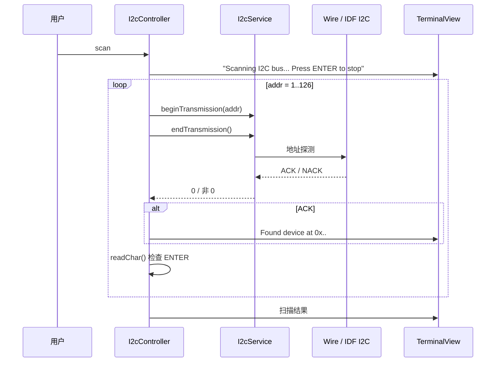

`I2cService::endTransmission()` 有一个细节：如果只发送地址、没有数据，Arduino-ESP32 3.3.x 会走 `i2c_master_probe()`，而该路径固定 100kHz，不受 `Wire.getClock()` 影响。因此项目在 IDF >= 5.4 时自己构造 `i2c_operation_job_t`，用 `i2c_master_execute_defined_operations()` 手动发地址字节，保证扫描/探测使用配置的时钟。

### 8.3 I2C sniff 的数据通路

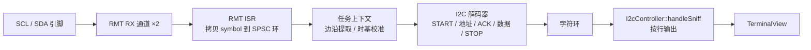

`I2cSnifferService` 不是用 GPIO 中断逐边沿采样，而是：

- 使用 ESP32-S3 RMT 的 RX 通道分别捕获 SCL 和 SDA；
- 支持 DMA 时使用 RMT DMA（`SOC_RMT_SUPPORT_DMA`）；
- ISR 只做“把 RMT symbol 拷贝进单生产者/单消费者环”，避免在中断里做重活；
- 任务上下文完成脉冲转换、epoch 对齐、校准、协议解码；
- 有溢出标志、地址过滤、丢包恢复；
- 缓冲区、`CaptureMemory` 等大对象只在第一次 `sniff` 时分配，退出 I2C 模式时释放。

`measureFrequency()` 也复用 RMT：捕获 SCL 边沿，统计周期、HIGH/LOW 时间、可靠样本数，然后让用户选择是否写回 `GlobalState`。

### 8.4 I2C Service 的能力面

`I2cService` 不只是一个 `Wire` 包装，它包含：

- 常规读写：`beginTransmission`、`write`、`endTransmission`、`requestFrom`、`read`；
- 寄存器探测：`ping`、`readReg`、`writeReg`、`probeRegRW`；
- bit-bang：手动 SCL/SDA 电平、起始/停止、读写字节、总线恢复；
- 从机：`Wire1.begin(address, ...)` + `onReceive/onRequest`，带环形日志；
- glitch：快速 start/stop、随机 flood、over-read、非法寄存器、时钟拉伸、ACK 注入等；
- EEPROM：通过 SparkFun `ExternalEEPROM` 封装；
- bytecode：`executeByteCode()`。

这体现了项目的通用模式：**Controller 负责“让用户能安全地发起操作”，Service 负责“把操作落到硬件”，Shell 负责“把多步操作组织成菜单”**。

---

## 9. 板级抽象

### 9.1 每块板暴露三个接口

`main.cpp` 对每块板做同样的三件事：

```cpp
board.initialize();
IDeviceView& deviceView = board.getDeviceView();
IInput& deviceInput = board.getDeviceInput();
IHostSerial& hostSerial = board.getHostSerial();
```

| 接口 | 作用 | 典型实现 |
|---|---|---|
| `IDeviceView` | 设备自带屏幕：logo、欢迎页、pinout、逻辑波形、模拟波形、瀑布图、旋转/亮度、水平选择菜单；无屏板子可用板载 RGB LED 指示当前模式 | `NoScreenDeviceView`、`RgbLedView`、`M5DeviceView`、`St7789SpiDeviceView`、`St7789ParallelDeviceView`、`Ili9341SpiDeviceView`、`CardputerDeviceView`、`TdisplayDeviceView`、`WaveshareS3GeekDeviceView` |
| `IInput` | 物理输入：按键、编码器、Cardputer 键盘 | `DefaultInput`、`StickInput`、`TEmbedInput`、`StampS3Input`、`TdisplayInput`、`CardputerInput`、`CustomInput` |
| `IHostSerial` | 与 PC/浏览器通信的主机串口 | `DefaultHostSerial`（USB CDC）、`UartHostSerial`（UART 桥） |

`BoardHostSerial` 是一个编译期别名：

```cpp
#if defined(DEVICE_HOST_SERIAL_UART)
using BoardHostSerial = UartHostSerial;
#else
using BoardHostSerial = DefaultHostSerial;
#endif
```

这允许某些板子用 UART 而不是原生 USB CDC 作为终端链路。

### 9.2 终端视图与设备视图是两套东西

这是理解 UI 的关键：

- `ITerminalView`：命令行的**文字输出**。Serial、Web、Cardputer 各一套。
- `IDeviceView`：设备**屏幕上的图形 UI**。即使终端是串口/网页，只要板子有屏幕，pinout、波形、菜单仍然显示在屏幕上。

`ActionDispatcher::setup()` 会先初始化 device view 并显示欢迎页；如果是串口，还会关闭 `Serial` 调试输出，避免日志污染 CLI。

### 9.3 Custom 板：不改代码接新板

`[env:custom]` 通过 `platformio.ini` 的 build flags 配置：

- `PROTECTED_PINS`：扫描器和交互式引脚选择要避开的 GPIO；
- `CUSTOM_INPUT_BUTTON_PIN` / 电平 / 上拉；
- `CUSTOM_DISPLAY_DRIVER_ST7789_SPI` / `ST7789_PARALLEL` / `ILI9341_SPI`；
- 屏幕几何、偏移、旋转、反色、RGB 顺序、背光/电源引脚；
- 主机串口：默认 USB CDC，或 `DEVICE_HOST_SERIAL_UART`；
- 各协议默认引脚：UART、I2C、SPI、1-Wire、2-Wire、3-Wire、IR、LED、I2S、CAN、Ethernet、Sub-GHz、RF24、LoRa、SD。

`CustomBoard` 根据这些宏在运行时选择 `NoScreenDeviceView` 或对应屏幕驱动，并把引脚交给 `GlobalState`。

### 9.4 板级抽象的代价

板级选择是**编译期宏**，不是运行时多态：

- 每块板编译一份固件；
- 新增板子通常要新增 env + 板类 + `main.cpp` 分支；
- `platformio.ini` 中 20 个 env 大量重复引脚块，容易出现配置漂移；
- `GlobalState` 同时保存编译期默认值和运行时可改值，调试时要区分“当前值来自宏还是用户命令”。

---

## 10. Web 子系统

### 10.1 组件关系

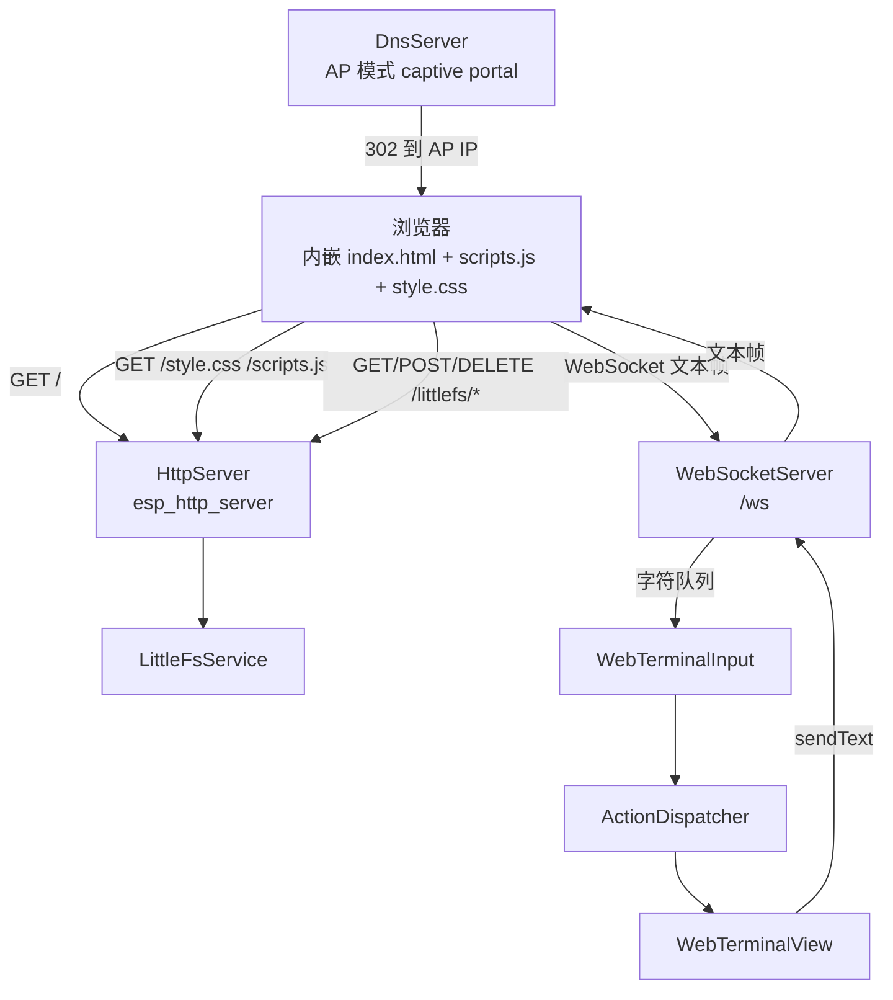

### 10.2 HTTP 路由

`HttpServer::setupRoutes()` 注册：

| 路由 | 方法 | 作用 |
|---|---|---|
| `/` | GET | 返回内嵌的 `index_html` |
| `/style.css` | GET | 返回内嵌 CSS |
| `/scripts.js` | GET | 返回内嵌 JS |
| `/littlefs/list?dir=/...` | GET | 列出 LittleFS 目录，返回 JSON |
| `/littlefs/upload?file=...` | POST | 分块上传文件 |
| `/littlefs/delete?file=...` | DELETE | 删除根目录文件 |
| `/littlefs/download?file=...` | GET | 分块下载文件 |

AP 模式额外注册 `/*` 捕获路由，302 重定向到 `http://<AP IP>/`，实现 captive portal。DNS 服务由 `DnsServer::configureCaptiveDns()` / `startCaptiveDns()` 启动。

Web UI **完全内嵌在固件**：`webui/index.h`、`scripts.h`、`style.h` 是 raw string literal，`HttpServer.h` 直接 `#include` 它们。因此即使 LittleFS 没有挂载，CLI 页面仍然可用；LittleFS 路由只用于文件管理。

### 10.3 WebSocket 终端

`WebSocketServer` 的行为：

- 握手请求是 GET，记录 `clientFd`；新客户端会关闭旧客户端；
- 每个文本帧的字节逐个压入 `static std::deque<char> buffer`；
- `readCharBlocking()` 空队列时 `delay(10)` 轮询；
- `readCharNonBlocking()` 空队列返回 `KEY_NONE`；
- `sendText()` 先做 UTF-8 清洗（丢弃非法序列），再 `httpd_ws_send_frame_async()`；
- 发送失败则 `closeClient()`，清空缓冲。

浏览器侧 `scripts.h`：

- 打开 `ws://<host>/ws`；
- 发送命令时自动补 `\n`；
- 对回显做过滤，避免命令重复显示；
- `bridge` / `keyboard` 命令进入 bridge mode，此时不做终端过滤，直接双向透传；
- 断线后 1 秒重连，并显示“WebSocket 丢失”弹窗；
- 支持历史、命令面板、发送按钮、特殊按键（ESC/Ctrl-C/Tab 等）。

### 10.4 限制与注意

- **单客户端**：`clientFd` 是静态单值，新连接会踢掉旧连接；`buffer` 也是静态单队列。
- **无鉴权**：HTTP/WS 没有登录或 token，设计假设是可信局域网；AP 默认密码在 `GlobalState` 中为 `readytoboard`。
- **阻塞式输入**：Web 终端读取仍是轮询队列；如果浏览器不发送字符，主循环会在 `readCommand()` 内空转。
- **发送是异步的**：`sendText()` 不等待发送完成；高频输出时仍可能受底层 TCP 缓冲影响。

---

## 11. 一次性 USB 适配器模式

### 11.1 设计目的

Bit Pirate 可以临时“变成”另一个 USB 设备，配合 PC 端现有工具使用，而不需要刷不同固件：

- USB-UART 桥
- flashrom serprog SPI 编程器
- AVRDUDE Bus Pirate
- SUMP logic analyzer（PulseView/sigrok）
- OpenOCD Bus Pirate JTAG/SWD
- USB IR Toy / LIRC
- Sub-GHz Raw CDC（CC1101）
- BPIO2（FlatBuffers + COBS）
- ESP32-S3 SDR（原始 RF/IQ，实验性）

### 11.2 进入与退出流程

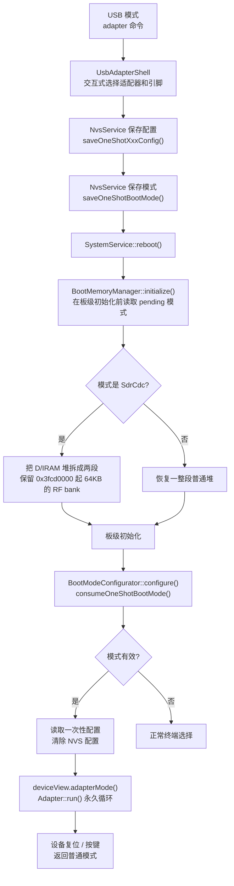

关键点：

- 适配器模式是**一次性**的：`consumeOneShotBootMode()` 读取后立即删除 NVS key；复位即恢复普通模式。
- 配置也是**一次性**的：引脚、频率等由 `UsbAdapterShell` 写入，`BootModeConfigurator` 读取后清除。
- `BootMemoryManager` 在板级初始化前就决定堆布局，因此 SDR 模式可以在启动时独占 RF 内存 bank，而不必在运行时再拆堆。

### 11.3 适配器与主机工具

| 适配器 | NVS 模式 | 主机侧典型工具 | 说明 |
|---|---|---|---|
| USB-UART Bridge | `UsbUartBridge` | picocom、PuTTY | CDC 波特率/数据位/校验/停止位映射到 `Serial1` |
| Flashrom Serprog | `FlashromSerprog` | flashrom | SPI 编程器 |
| AVRDUDE Bus Pirate | `AvrDudeBusPirate` | avrdude | AVR ISP |
| SUMP Logic Analyzer | `SumpLogicAnalyzer` | PulseView/sigrok | 8 通道，SUMP 协议 |
| OpenOCD Bus Pirate | `OpenOcdBusPirate` | OpenOCD | JTAG/SWD |
| IR Toy | `InfraredToy` | LIRC `mode2` | 红外收发 |
| SubGHz Raw CDC | `SubGhzRawCdc` | 串口工具/脚本 | CC1101 原始 OOK |
| BPIO2 | `Bpio2` | Bus Pirate 客户端 | FlatBuffers + COBS，支持 SPI/I2C/GPIO |
| SDR CDC | `SdrCdc` | ESP-SDR 工具 | 2.2–2.8GHz 原始 RF/IQ |

### 11.4 SDR 内存布局

`BootMemoryManager` 中：

```text
SDR_BANK_START = 0x3fcd0000
SDR_BANK_BYTES = 65536
```

普通模式把 `_heap_start` 到 `poolEnd` 注册为一整段堆。  
SDR 模式只注册 `[_heap_start, bankStart)` 和 `[bankEnd, poolEnd)`，把中间 64KB 留给 RF 专用。这样做的目的在源码注释中写得很清楚：避免把最大可分配块永久切碎，同时让 SDR 捕获服务在 `isSdrBankReserved()` 为真时使用固定 RF bank。

---

## 12. 嗅探、分析与并发

### 12.1 被动嗅探

| 嗅探器 | 实现 | 特点 |
|---|---|---|
| I2C | `I2cSnifferService` + RMT | 双通道 SCL/SDA，DMA，ISR→SPSC 环，任务解码，地址过滤，频率测量 |
| UART | `UartSnifferService` | 同时监听两个硬件串口，文本/原始两种模式 |
| WiFi | `WifiService` | 抓包/扫描/deauth 等，依赖 ESP-IDF Wi-Fi 底层 |
| Bluetooth | `BluetoothService` | BLE 扫描、广播、HID 等 |
| Sub-GHz | `SubGhzService` + `SubGhzAnalyzer` | CC1101 原始波形/协议分析 |
| CAN | `CanService` | MCP2515 帧收发 |

### 12.2 I2C 嗅探的并发模型

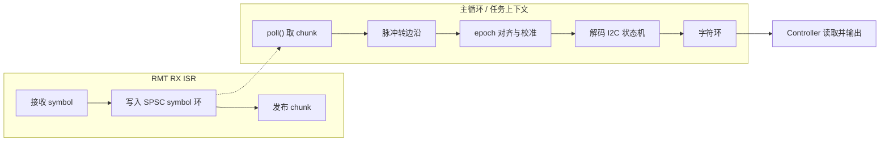

这个设计的目标是：中断里不做协议解码，避免高时钟下丢边沿；解码失败/溢出有显式标志，便于提示用户。

### 12.3 其他分析器

- `BinaryAnalyzer`：二进制/十六进制 dump、差异、模式查找等；
- `PinAnalyzer`：GPIO 电平、频率、逻辑分析、模拟绘图；
- `I2cFrequencyAnalyzer`：从 RMT 捕获样本计算频率、周期、占空比、可靠性；
- `SubGhzAnalyzer`：Sub-GHz 脉冲/协议分析。

### 12.4 并发边界

固件整体是**协作式单线程**：

- 主 CLI 在 `ActionDispatcher::run()` 中阻塞读命令；
- 长操作（sniff、scan、monitor、replay）内部循环并轮询 `terminalInput.readChar()` 以支持 ENTER 停止；
- 网络相关功能（ICMP ping、discovery、Wi-Fi 抓包等）使用 FreeRTOS task；
- I2C RMT 使用 ISR + 主循环轮询；
- WebSocket 的接收由 HTTP server 任务回调完成，主循环只读队列。

因此“实时性”取决于具体命令：嗅探/逻辑分析尽量把重活放到 ISR/任务/环形缓冲，普通 CLI 操作则是同步阻塞。

---

## 13. 状态、内存与存储

### 13.1 GlobalState

`GlobalState` 是 721 行的单例，保存：

- 固件版本、当前模式、终端类型/IP；
- 每个协议的引脚、速率、位宽、校验、极性等配置；
- AP 名称/密码、NVS key 名称；
- 保护引脚列表、JTAG 扫描引脚；
- SD 卡文件数量/缓存限制；
- USB VID/PID/字符串。

它在构造函数中读取 `-D*_PIN` 等宏，所以 **build flags 是默认值的来源**。运行时命令（`config`、`swap`、`profile`）会修改这些值；`ProfileShell` 可以把整套配置保存成 `.profile` 文件并重新加载。

### 13.2 NVS

`NvsService` 封装 Arduino `Preferences`，命名空间由 `INvsService::NVS_NAMESPACE` 定义。主要保存：

- Wi-Fi SSID/密码；
- 一次性适配器模式与各适配器配置；
- 其他需要跨重启保存的少量键值。

`BootMemoryManager` 不使用 `NvsService`，而是直接 `nvs_open` 读取 pending 模式，因为它必须在 Arduino 初始化之前运行。

### 13.3 LittleFS / SD

`LittleFsService` 提供：

- 挂载/格式化；
- 列目录、读、写、追加、删除、重命名、递归删除；
- 空间统计；
- 路径规范化与根目录文件名安全校验；
- MIME 类型推断。

用途：

- `.profile` 配置文件（`ProfileShell`）；
- 红外 `.ir` 文件（`UniversalRemoteShell`）；
- 脚本/数据文件；
- Web `/littlefs/*` 文件管理；
- SD 卡模式（`SdCardShell`、`SdService`）。

### 13.4 内存策略

项目对 RAM 非常敏感，`CONTRIBUTING.md` 明确要求：

- 避免启动时创建全局/静态容器和大缓冲；
- 优先 `const`/`constexpr`、flash 表、栈上临时对象、按需分配；
- 新增功能要考虑永久分配会累积。

代码中的体现：

- `DependencyProvider` 放堆上；
- I2C 嗅探的大结构体 `CaptureMemory` 第一次 sniff 才分配；
- `sniffLine` 懒 reserve、退出模式时 `swap` 释放；
- Web UI 字符串放 flash（`const char*` raw literal）；
- `BootMemoryManager` 精细控制 D/IRAM 堆布局；
- 多处使用 `heap_caps_malloc(..., MALLOC_CAP_INTERNAL | MALLOC_CAP_DMA)`。

---

## 14. 测试与 CI

### 14.1 原生测试

`[env:native-tests]` 使用：

```ini
platform = native
build_flags = -std=gnu++17
lib_deps = throwtheswitch/Unity@^2.6.1
test_build_src = no
test_framework = unity
```

`test/test_main.cpp` 直接 `#include` 生产源文件（如 `../src/Controllers/I2cController.cpp`），再 `#include` 各测试套件。这样做的原因是：

- 不需要为每个平台编译完整固件；
- 可以用 `FakeTerminalView`、`FakeInput`、`FakeI2cService` 等替身隔离硬件；
- `TestGlobalState.h` 在每个测试 `setUp()` 中重置全局状态。

测试覆盖：

- Transformers：参数、命令、指令、Pinout、AT、红外、BPIO2、LoRa、Sub-GHz、Profile、JSON、Web 请求；
- Controllers：I2C、SPI、UART、DIO、LED、Wi-Fi、BLE、LoRa、CAN 等；
- Managers：历史、别名、命令行、用户输入；
- Analyzers、Enums、Selectors、Shells、网络控制器；
- I2C 嗅探相关的 Fake/RMT 替身。

`test/Adapters/*.py` 是硬件/适配器冒烟测试（IR Toy、SDR、Sub-GHz Raw CDC 等），不参与 native 测试。

### 14.2 GitHub Actions

| 工作流 | 作用 |
|---|---|
| `native-tests.yml` | push/PR 时运行 `pio test -e native-tests` |
| `firmware-resource-delta.yml` | 对指定分支比较前后两次提交的 RAM/Flash 占用 |
| `weekly-firmware-health.yml` | 每周构建固件健康报告（RAM/Flash/警告等） |
| `upstream-firmware-delivery.yml` | 上游固件交付流程 |

资源 delta 工作流说明项目把 **RAM/Flash 回归**当作一等公民；这也解释了为什么很多地方采用懒分配和静态常量。

> 本文写作环境未安装 PlatformIO，因此没有实际执行 `pio test`；测试结论来自对 `test/` 与 CI 配置的静态阅读。

---

## 15. 扩展点：改哪里

### 15.1 新增一个命令

以在 I2C 模式新增 `foo` 为例，需要触碰：

1. `src/Controllers/I2cController.h`：声明 `handleFoo(...)`；
2. `src/Controllers/I2cController.cpp`：
   - 在 `handleCommand()` 增加 `else if (cmd.getRoot() == "foo") handleFoo(cmd);`
   - 实现 `handleFoo()`，用 `terminalView` 输出、`argTransformer` 校验、`i2cService` 操作；
3. `src/Shells/HelpShell.cpp`：把命令加入 I2C 帮助；
4. `src/Data/AutoCompleteWords.h`：加入补全词；
5. `test/Controllers/test_I2cController.cpp`：用 Fake 服务写行为测试。

如果命令是全局的（不属于某个模式），还要：

- `TerminalCommandTransformer::isGlobalCommand()`；
- `UtilityController::handleCommand()`；
- 必要时 `isScreenCommand()` 触发 pinout 重绘。

### 15.2 新增一个模式

新增模式是“重”改动，涉及：

1. `src/Enums/ModeEnum.h`：枚举 + 名称映射；
2. `src/Interfaces/IXxxService.h`：服务接口；
3. `src/Services/XxxService.h/.cpp`：硬件实现；
4. `src/Controllers/XxxController.h/.cpp`：命令分派与交互；
5. `src/Providers/DependencyProvider.h/.cpp`：
   - 成员、构造、getter；
   - 把服务注入控制器；
6. `src/Dispatchers/ActionDispatcher.cpp`：
   - `dispatchCommand()` 增加 case；
   - `setCurrentMode()` 增加 `ensureConfigured()`；
   - `releaseMode()` 如需释放；
   - `dispatchInstructions()` 如需 bytecode；
7. `src/Transformers/PinoutTransformer.cpp`：屏幕 pinout；
8. `src/Shells/HelpShell.cpp`：帮助；
9. `src/Data/AutoCompleteWords.h`：补全；
10. `test/`：Fake 服务 + Controller 测试；
11. `platformio.ini`：各板引脚宏（如果模式需要固定引脚）。

### 15.3 新增一块板

优先走 `[env:custom]`：

- 复制 `[env:custom]`，改 `board`、`PROTECTED_PINS`、按键、显示驱动、协议引脚；
- 如果有板载特殊硬件（屏幕驱动、电源控制、键盘），再新增 `src/Boards/<Board>/`：
  - `XxxBoard.h/.cpp`：`initialize()` + 三个 getter；
  - `XxxDeviceView`：继承 `IDeviceView` 或复用 `M5DeviceView` / `St7789SpiDeviceView`；
  - `XxxInput`：继承 `IInput`；
  - 必要时 `XxxWifiSetup`；
- `src/main.cpp` 增加 `#elif defined(DEVICE_XXX)` 分支；
- `platformio.ini` 增加 env。

### 15.4 新增一个 USB 适配器

1. `src/Enums/OneShotBootMode.h`：新增枚举值（保持已保存数值兼容）；
2. `src/Services/NvsService.h/.cpp`：保存/读取/清除该适配器配置；
3. `src/Adapters/XxxAdapter.h/.cpp`：实现 `run(config, input, hostSerial)`；
4. `src/Configurators/BootModeConfigurator.cpp`：
   - 构造默认配置；
   - 读取 NVS；
   - `showOneShotBootMode()` 显示信息；
   - `switch(mode)` 调用 Adapter；
5. `src/Shells/UsbAdapterShell.cpp`：交互式收集参数、写 NVS、重启；
6. 如果适配器需要特殊内存布局，扩展 `BootMemoryManager`；
7. 如果协议复杂，增加 `src/Models/` + `src/Transformers/` 和 native 测试。

---

## 16. 设计观察与风险点

### 16.1 做得好的地方

- **职责分离清晰**：Controller / Service / Shell / Transformer 边界稳定，新增协议有明确落点。
- **接口化 + Fake 测试**：Controller 不依赖具体硬件，native 测试可以覆盖大量命令逻辑。
- **板级编译期隔离**：不同板子不把无关驱动编进固件，适合资源受限场景。
- **内存意识强**：懒分配、flash 字符串、堆布局控制、资源 delta CI。
- **适配器模式很实用**：一套固件通过 NVS + 重启切换成多种标准 USB 工具。

### 16.2 需要留意的点

1. **全局单例 + 可变状态**  
   `GlobalState` 被 Controller、Service、Transformer 广泛引用；模式切换、Profile 加载、`config/swap` 命令都会改它。研究单个功能时，必须同时看“谁修改了这些字段”，否则容易误判。

2. **手工依赖注入的维护成本**  
   `DependencyProvider` 持有几乎所有对象，构造函数参数很长；新增服务要同时改头文件、成员、初始化列表、getter、Controller 构造。它换来的是明确的生命周期和可测试性，但确实是一个“大装配点”。

3. **`disableAllProtocols()` 当前是空实现**  
   回到 HIZ 不会统一关闭所有协议；跨模式资源释放依赖 `releaseMode()` 和 `ensureConfigured()`。新增模式时如果忘了在 `releaseMode()` 处理重资源，可能留下外设/中断/DMA 未释放。

4. **单线程阻塞命令**  
   长操作必须在循环里轮询 `terminalInput.readChar()` 才能响应 ENTER；如果新命令写成纯阻塞循环，Web/串口都会“卡住”。这是新增命令时最容易踩的坑。

5. **Web 终端是单客户端、无鉴权**  
   `WebSocketServer` 的 `clientFd`/`buffer` 是静态单例；新浏览器会踢掉旧浏览器。HTTP/WS 没有登录机制，默认假设可信局域网。不要把设备暴露到不可信网络。

6. **编译期引脚与运行时引脚双源**  
   `platformio.ini` 的宏提供默认值，`GlobalState` 保存运行时值，Profile 又能覆盖。调试“为什么引脚不对”时，要按“宏 → GlobalState 构造 → 用户命令/Profile”顺序排查。

7. **20 个 env 的重复配置**  
   每块板的引脚块大量复制，新增/修改协议引脚时容易漏改某个 env。CI 的固件健康/资源报告能发现构建问题，但不会发现“引脚语义错误”。

8. **部分协议依赖第三方库行为**  
   I2C 的 `Wire`、红外 `IRremoteESP8266`、Sub-GHz `SmartRC-CC1101`、LoRa `SX126x-Arduino`、CAN `MCP2515` 等都有各自的时序/缓冲特性；项目在关键处做了适配（如 I2C probe 绕过 100kHz 限制、RMT 嗅探），但升级库版本时仍需回归硬件测试。

---

## 17. 建议阅读路线

如果目标是“完整理解这个项目”，建议按以下顺序：

| 顺序 | 读什么 | 目标 |
|---|---|---|
| 1 | `src/main.cpp` | 启动、板级选择、终端选择、Provider/Dispatcher 装配 |
| 2 | `src/Dispatchers/ActionDispatcher.cpp` | 主循环、命令分派、模式切换 |
| 3 | `src/Transformers/TerminalCommandTransformer.cpp`、`InstructionTransformer.cpp` | 命令语法、bytecode |
| 4 | `src/Managers/CommandLineManager.cpp` | 行编辑、历史、补全 |
| 5 | `src/Providers/DependencyProvider.h/.cpp` | 所有组件的依赖关系图 |
| 6 | `src/States/GlobalState.h` | 全局配置、引脚、模式 |
| 7 | `src/Controllers/I2cController.cpp` + `src/Services/I2cService.cpp` + `I2cSnifferService.cpp` | 最完整的 Controller/Service/嗅探案例 |
| 8 | `src/Boards/` + `platformio.ini` 的一个 env | 板级抽象和编译期配置 |
| 9 | `src/Servers/` + `webui/` + `src/Views/WebTerminalView.cpp` | Web 终端数据通路 |
| 10 | `src/Configurators/BootModeConfigurator.cpp` + `src/Adapters/` + `BootMemoryManager` | 一次性适配器和内存布局 |
| 11 | `test/` + `.github/workflows/` | 可测试性与质量门禁 |

---

## 附录：关键文件索引

| 主题 | 文件 |
|---|---|
| 启动入口 | `src/main.cpp` |
| 主循环/命令分派 | `src/Dispatchers/ActionDispatcher.cpp`、`.h` |
| 命令解析 | `src/Transformers/TerminalCommandTransformer.cpp`、`src/Models/TerminalCommand.h` |
| Bytecode | `src/Transformers/InstructionTransformer.cpp`、`src/Models/ByteCode.h`、`src/Enums/ByteCodeEnum.h` |
| 行编辑/历史/补全 | `src/Managers/CommandLineManager.cpp`、`CommandHistoryManager.cpp`、`src/Data/AutoCompleteWords.h` |
| 依赖装配 | `src/Providers/DependencyProvider.h/.cpp` |
| 全局状态 | `src/States/GlobalState.h` |
| 模式枚举 | `src/Enums/ModeEnum.h` |
| 终端类型 | `src/Enums/TerminalTypeEnum.h` |
| 终端视图 | `src/Views/SerialTerminalView.cpp`、`WebTerminalView.cpp`、`src/Boards/Cardputer/CardputerTerminalView.cpp` |
| 终端输入 | `src/Inputs/SerialTerminalInput.cpp`、`WebTerminalInput.cpp` |
| 设备视图接口 | `src/Interfaces/IDeviceView.h` |
| 输入接口 | `src/Interfaces/IInput.h` |
| 主机串口 | `src/Interfaces/IHostSerial.h`、`src/Boards/Common/Serial/` |
| 板级实现 | `src/Boards/*/` |
| Custom 板 | `src/Boards/Custom/`、`platformio.ini` 的 `[env:custom]` |
| HTTP/WebSocket/DNS | `src/Servers/`、`webui/` |
| I2C 控制器 | `src/Controllers/I2cController.cpp` |
| I2C 服务 | `src/Services/I2cService.cpp` |
| I2C 嗅探 | `src/Services/I2cSnifferService.cpp`、`.h` |
| UART 嗅探 | `src/Services/UartSnifferService.cpp`、`.h` |
| 一次性适配器 | `src/Configurators/BootModeConfigurator.cpp`、`src/Adapters/`、`src/Shells/UsbAdapterShell.cpp` |
| 启动内存 | `src/Managers/BootMemoryManager.cpp`、`.h` |
| NVS | `src/Services/NvsService.cpp`、`.h` |
| LittleFS | `src/Services/LittleFsService.cpp`、`.h` |
| 测试入口 | `test/test_main.cpp` |
| CI | `.github/workflows/native-tests.yml`、`firmware-resource-delta.yml`、`weekly-firmware-health.yml` |

---

## 总结（一句话版）

ESP32 Bit Pirate 的核心不是某一个协议，而是 **“终端输入抽象 + CommandLineManager + ActionDispatcher + Controller/Service/Shell + GlobalState + 编译期板级配置”** 这一套可复用的固件骨架；协议、屏幕、USB 适配器和 Web 终端都是挂在这套骨架上的插件。理解 `main.cpp → ActionDispatcher → DependencyProvider → Controller → Service` 这条主链，再按需深入某个模式的 Service，就能覆盖整个项目。
